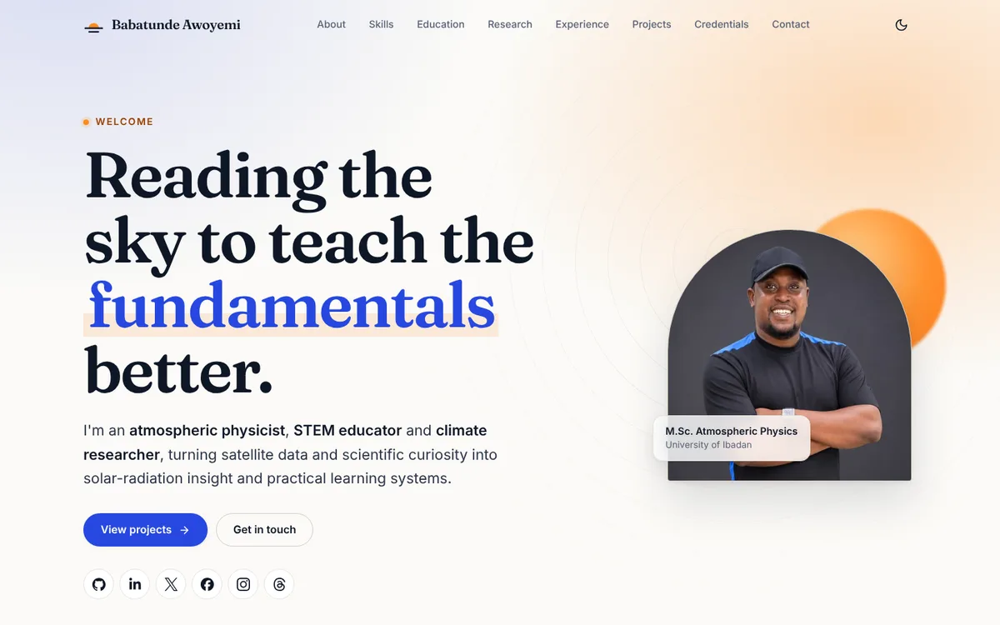
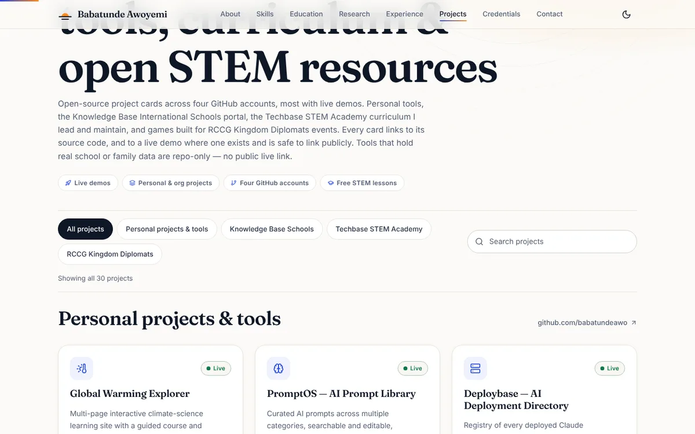

<div align="center">

<picture>
  <source media="(prefers-color-scheme: dark)" srcset="docs/assets/logo-dark.svg">
  
</picture>

# Babatunde Ayoola Awoyemi

**Atmospheric physicist, STEM educator and climate researcher.**

[](https://github.com/babatundeawo/babatundeawo.github.io/actions/workflows/deploy.yml)
[](https://github.com/babatundeawo/babatundeawo.github.io/actions/workflows/codeql.yml)
[](https://babatundeawo.github.io/)

[Live site](https://babatundeawo.github.io/) · [Projects](https://babatundeawo.github.io/projects.html) · [Report an issue](https://github.com/babatundeawo/babatundeawo.github.io/issues)

</div>



## About

The personal site of Babatunde Ayoola Awoyemi, a Nigerian atmospheric physicist, STEM educator and EdTech consultant. It sets out his research in solar irradiance and wind-energy statistics, his teaching and consulting work in schools, and his credentials and contact details. It also catalogues the tools, school systems, learning sites and games he has built across four GitHub accounts, each with a live site and its source code. It is written for collaborators, schools, students and anyone curious about the work.

## Features

- A single-page profile covering about, skills, education, research, experience, credentials and contact.
- A searchable, filterable catalogue of projects across four GitHub accounts. Every project links to its live site and its GitHub repository.
- Light and dark themes that follow your system setting and remember your choice.
- Keyboard-friendly navigation, a skip link, reduced-motion support and a printable layout.
- A one-click "Copy" button for the email address.

## How to use it

1. Open the [live site](https://babatundeawo.github.io/) and scroll, or use the menu to jump to a section.
2. Visit [Projects](https://babatundeawo.github.io/projects.html). Use the group buttons or the search box to narrow the list. A link such as `projects.html#kbi` opens a single group directly.
3. Choose **Live site** on a card to open the project, or **GitHub repo** to read its code. School and records tools open to a sign-in screen and are available only to approved staff.
4. Use the sun/moon button in the header to switch between light and dark.
5. Get in touch from the [Contact](https://babatundeawo.github.io/#contact) section by email or any linked profile.



## Tech stack

- Hand-written HTML, CSS and JavaScript. No framework and no runtime dependencies.
- Self-hosted fonts and an inline SVG icon sprite, so pages make no third-party requests.
- GitHub Actions for checks and deployment to GitHub Pages; CodeQL and Dependabot for security upkeep.

## Project structure

```text
.
├── index.html            Home page
├── projects.html         Project catalogue
├── 404.html              Not-found page
├── css/style.css         Design tokens and all styles
├── js/main.js            Theme, menu, reveal effects, project filter
├── assets/
│   ├── fonts/            Self-hosted web fonts and their licences
│   ├── icons/            Favicon and app icons
│   └── images/           Portrait (AVIF, WebP, JPEG) and social preview image
├── docs/                 Owner guides and README images
├── scripts/              Build check used by the deploy workflow
└── .github/              Deployment, CodeQL and Dependabot configuration
```

## Contributing

Spotted a typo, a broken link or an accessibility problem? [Open an issue](https://github.com/babatundeawo/babatundeawo.github.io/issues) on GitHub and describe what you saw and on which page. Pull requests that fix a specific problem are welcome.

## Security

To report a vulnerability privately, see [SECURITY.md](SECURITY.md).

## Credits

- Fonts: [Fraunces](https://github.com/undercasetype/Fraunces) and [Inter](https://github.com/rsms/inter), both under the SIL Open Font License 1.1.
- Icons: [Lucide](https://lucide.dev) (ISC), [Simple Icons](https://simpleicons.org) (CC0) and [Font Awesome Free](https://fontawesome.com) LinkedIn glyph (CC BY 4.0).

Site content and portrait &copy; Babatunde Ayoola Awoyemi.

## Contact

[babatundeawoyemi91@gmail.com](mailto:babatundeawoyemi91@gmail.com) · [LinkedIn](https://www.linkedin.com/in/ba-awoyemi/) · [GitHub](https://github.com/babatundeawo)
